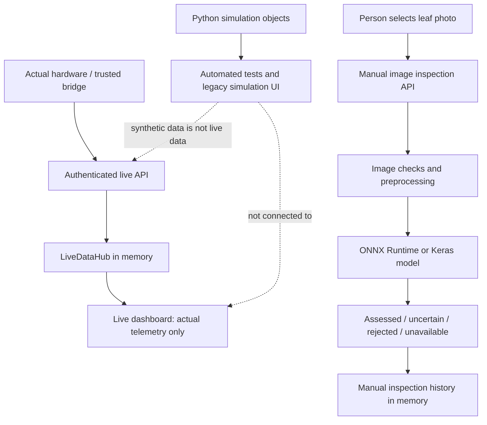
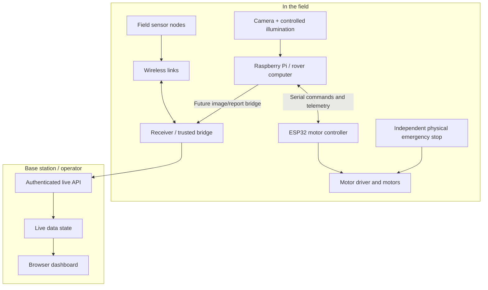
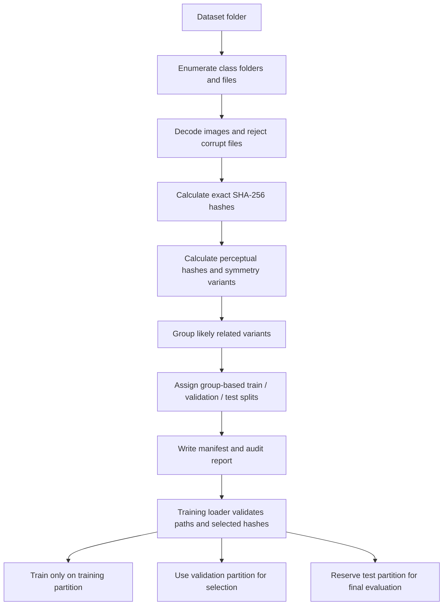

# Plant Health Rover — Complete Beginner-Friendly Project Guide

**Purpose:** A deep, code-informed explanation of the Plant Health Rover project, written for a student starting from zero. It explains the current application, machine-learning pipeline, older simulation/test system, communication protocol, embedded firmware, dataset/evaluation limits, setup, API, debugging, safety, and next steps.

**Expected project folder:** `/home/mano/Documents/Anveshion/plant-health-rover-sim/`  
**Suggested guide location:** `/home/mano/Documents/Anveshion/PLANT_HEALTH_ROVER_COMPLETE_GUIDE.md`  
**Source reviewed:** Uploaded `plant-health-rover-sim_corrected(3).zip`, including Python source, HTML pages, model artifacts, protocol definitions, ESP32 firmware, documentation, dataset manifest/audit records, and tests.  
**Review date:** 26 October 2026.

> I can create the guide in the chat's file workspace, but cannot directly save into your Ubuntu home directory from this chat. Download this file and copy it to the suggested location. Paths in the examples assume the repository is in `Anveshion/plant-health-rover-sim/`; adjust them if yours differs.

## Table of Contents

1. [The project in simple words](#1-the-project-in-simple-words)
2. [Implemented, separate, and not-yet-real parts](#2-implemented-separate-and-not-yet-real-parts)
3. [Architecture at a glance](#3-architecture-at-a-glance)
4. [Repository map](#4-repository-map)
5. [Run the current application](#5-run-the-current-application)
6. [Live-only dashboard and real-data flow](#6-live-only-dashboard-and-real-data-flow)
7. [Manual leaf-image inspection](#7-manual-leaf-image-inspection)
8. [Model, MobileNetV2 and evaluation](#8-model-mobilenetv2-and-evaluation)
9. [Dataset audit and training pipeline](#9-dataset-audit-and-training-pipeline)
10. [Older simulation system](#10-older-simulation-system)
11. [Communication protocols](#11-communication-protocols)
12. [ESP32 firmware and physical hardware](#12-esp32-firmware-and-physical-hardware)
13. [Storage, APIs and module responsibilities](#13-storage-apis-and-module-responsibilities)
14. [Security and physical safety](#14-security-and-physical-safety)
15. [Test results](#15-test-results)
16. [Important mismatches to fix](#16-important-mismatches-to-fix)
17. [Recommended development plan](#17-recommended-development-plan)
18. [Previous conversation context](#18-previous-conversation-context)
19. [Glossary](#19-glossary)
20. [External references](#20-external-references)
21. [Final checklist](#21-final-checklist)

---

# 1. The project in simple words

## 1.1 What problem is this project trying to solve?

A plant-health rover is a small mobile robot intended to help inspect plants. Imagine a tomato field. A person or a rover takes leaf pictures. Sensors may also measure soil moisture, temperature, humidity, or other properties. Software collects this information and presents it to an operator. A machine-learning model may examine a leaf photo and suggest which visual disease pattern it resembles.

A complete future system could contain a rover, camera, sensors, ESP32 microcontroller, wireless links, a base station/computer, an AI image classifier, and a dashboard. The uploaded project contains software for several responsibilities, but **they are not all connected to physical hardware yet**.

## 1.2 The three separate workflows in the downloaded project

1. **Live-only dashboard.** It shows genuine device data only after a trusted device bridge forwards it to the authenticated local API. It does not invent readings to fill the screen.
2. **Manual PC-side leaf-image inspection.** A person uploads a leaf image from a browser. The PC attempts to run a MobileNetV2-based classifier and returns a cautious visual assessment. It does not require a connected rover and does not create sensor readings.
3. **Older simulation and test system.** Python classes create virtual sensors, cameras, radio/serial links, failures, ACKs, and reports. It tests software behavior, but the current default dashboard does not start it or display its synthetic readings.

These paths are deliberately isolated. Uploading a leaf image must not make the UI claim that a real rover is online. Empty sensor cards must not be filled with made-up moisture values just to make a screenshot look complete.

## 1.3 What the project does not prove today

The project is **not yet a field-validated autonomous plant doctor**. The bundled code does not prove that a physical rover navigates rows reliably; the motor driver and emergency stop have been validated under real load; the chosen radios comply with the intended frequency; real sensors are calibrated; the classifier achieves its benchmark on independent field photos; the AI output is a confirmed agronomic diagnosis; or the full hardware-to-dashboard path is connected.

The repository is a useful software foundation with a model artifact and a test-oriented simulation. It still needs protocol reconciliation, hardware integration, measured bench tests, and independent field evaluation before its output should guide real farming decisions.

## 1.4 An easy analogy

Think of the project as a car prototype:

- The dashboard is the display inside the car.
- The live API is the place where real electronics would send speed/fuel readings.
- The manual image inspector is a separate laptop tool.
- The simulation is a driving simulator that tests logic before the real car exists.
- ESP32 firmware is draft embedded control software.

A simulator showing speed does not prove that the real car is moving. Similarly, passing a software simulation test does not prove that rover motors, radios, sensors, or field diagnosis work correctly.

---

# 2. Implemented, separate, and not-yet-real parts

| Area | Present in source | Practical meaning |
|---|---|---|
| Live dashboard | `plant_rover/static/live.html`, `live_server.py`, `live_mode.py` | Local UI and API state manager for real messages. Starts empty when no devices are connected. |
| Manual image inspection | Browser tab, `plant_rover/ml/image_classifier.py`, model files | Upload a photo and try local inference. No sensor fusion in this workflow. |
| ML model | MobileNetV2 Keras and ONNX files, manifest, centroids, metadata | Trained artifact is bundled; a compatible inference runtime is still needed. |
| Dataset tools | Audit, manifest, evaluator, trainer, benchmark and profiler | The tools exist, but training dependencies are not all in the basic requirements file. |
| Software simulation | `engine.py`, `sensors.py`, `vision.py`, `transports.py`, `scenarios.py`, old `server.py` | Virtual data/faults are useful for tests, not a physical hardware test. |
| Protocol codec | `protocol.py`, `models.py`, `docs/PROTOCOL_SPEC.md` | Python framing, CRC checks, typed messages and simulated reliability behavior. |
| ESP32 firmware example | `firmware/esp32_rover_controller/` | Integration starting point; payload, ACK and byte order still need reconciliation with Python. |
| Physical adapters | `hardware_adapters.py` | Optional Picamera2/serial/modem paths, not automatically launched by the current dashboard. |
| Physical radio/sensor bridge | Plans and partial boundaries | No complete verified polling bridge is wired into `live_server.py`. |
| Navigation/row detection | Discussed in target architecture | Do not assume row detection, obstacle avoidance or closed-loop navigation is already working physically. |
| Farm recommendations | Provisional rules and visual labels | Development aids, not a substitute for an agronomist or verified diagnosis. |

## 2.1 Three flows at a glance



Dotted arrows mean *there is no such connection*. The simulator does not feed the current live dashboard.

---

# 3. Architecture at a glance

## 3.1 Intended future hardware architecture



This is a **target concept**, not a claim that all arrows exist in the implementation. The live API and UI exist, but a verified bridge from physical hardware is still needed. The physical emergency stop is independent of the dashboard.

## 3.2 Responsibility layers

- **HTTP/UI layer:** receives web requests and serves HTML/JSON.
- **Live-data layer:** validates, timestamps, stores and expires device observations.
- **Image-inference layer:** validates uploaded images and invokes a trained model.
- **Domain models:** define readings, reports, enums and messages.
- **Protocol/transport layer:** encodes bytes, checks CRC and simulates loss/corruption/retries.
- **Simulation engine:** coordinates virtual scenario steps.
- **Storage layer:** persists old simulator records in SQLite.
- **Hardware adapters:** bridge generic software interfaces to physical devices.
- **ML tooling:** audits data, trains MobileNetV2, exports artifacts and computes metrics.

The separation makes it easier to replace a fake sensor with a real sensor later, but only if the interface and protocol contracts are consistent and the physical adapter is actually integrated into the running application.

---

# 4. Repository map

Start with the files that control the main workflows, then follow the details into their helper modules.

## 4.1 Root files

| File | Purpose | When to open it |
|---|---|---|
| `README.md` | Run instructions, live-only rules, image inspection and training notes | Read first, but verify commands against source because parts are stale. |
| `pyproject.toml` | Package metadata and supported Python version | Says Python `>=3.11`; declares Pillow as a dependency. |
| `requirements.txt` | Runtime packages | Contains Pillow, NumPy, SciPy and ONNX Runtime. |
| `uv.lock` | Dependency lockfile for a `uv` workflow | Use only if using that package manager and matching environment. |

## 4.2 Main Python package: `plant_rover/`

| File | Responsibility | Beginner explanation |
|---|---|---|
| `__init__.py` | Package marker / metadata | Helps Python recognize the package. |
| `__main__.py` | Package execution | Allows `python -m plant_rover`. |
| `cli.py` | Command-line entry point | Parses `serve`, host and port; launches the live-only server. |
| `live_server.py` | Current HTTP server | Serves current HTML, live APIs, token checks and image upload endpoint. |
| `live_mode.py` | Live state manager | Tracks accepted device messages, readings, reports, freshness and events in memory. |
| `static/live.html` | Current dashboard | Contains live telemetry and manual PC image-inspection workflows. |
| `ml/image_classifier.py` | Manual photo inference | Validates images, loads ONNX/Keras if possible, predicts and defers/rejects weak inputs. |
| `models/plant_disease_mobilenetv2.onnx` | Portable model artifact | Used first when ONNX Runtime is installed and model load succeeds. |
| `models/plant_disease_mobilenetv2.keras` | Keras model artifact | Fallback; requires TensorFlow/Keras runtime. |
| `models/class_manifest.json` | Input/classes/thresholds | Must agree with output class order and preprocessing. |
| `models/model_metadata.json` | Recorded training metrics | Includes version, split counts, metrics and class-wise report. |
| `models/class_centroids.npy` | Class feature centroids | Extra class-similarity/ambiguity evidence, not a diagnosis by itself. |
| `engine.py` | Legacy simulation orchestration | Advances virtual scenarios, sends commands/reports, handles retries and simulated safety states. |
| `server.py` | Legacy simulation web server | Serves the old simulator page and simulation controls; not the current CLI default. |
| `static/index.html` | Legacy simulation UI | Older simulation controls/visualization. |
| `models.py` | Data structures and enums | Defines readings, reports, assessment/radio types and message concepts. |
| `protocol.py` | Binary codecs | Encodes/decodes serial/radio messages and checks CRC/framing. |
| `transports.py` | Simulated communication | Injects loss/corruption/duplication/latency and simulates ACKs/retries/virtual ESP32. |
| `hal.py` | Hardware abstraction interfaces | Defines camera, serial, radio, motor, sensor, notifier and clock contracts; includes state transitions. |
| `hardware_adapters.py` | Optional physical adapters | Picamera2, serial and modem paths; not automatically connected to `live_server.py`. |
| `sensors.py` | Virtual sensors | Generates repeatable healthy/stress/conflict/low-battery test traces. |
| `vision.py` | Simulation camera/quality gate | Creates or returns test images; distinct from ML inference in `image_classifier.py`. |
| `fusion.py` | Demonstration rule engine | Combines sample sensor values and cues with provisional rules; not validated agronomy. |
| `storage.py` | Simulation SQLite storage | Persists legacy simulation data/events/reports; live hub is in-memory. |

## 4.3 Machine-learning modules: `plant_rover/ml/`

| File | Purpose |
|---|---|
| `image_classifier.py` | Runtime image-only inference and uncertainty policy. |
| `train_classifier.py` | Two-stage MobileNetV2 training, evaluation and artifact export. |
| `dataset_audit.py` | Audits files, hashes/near-duplicates and split groups. |
| `manifest.py` | Loads/validates dataset split manifest. |
| `evaluator.py` | Evaluation/metrics helpers. |
| `benchmark_architectures.py` | Compares candidate network architectures. |
| `profiler.py` | Measures inference performance. |
| `model.py` | Older/experimental model code; not the same class as the `PlantLeafClassifier` used by the live server. |

## 4.4 ESP32 firmware

- `firmware/esp32_rover_controller/protocol.h`: C/C++ protocol constants and payload structures.
- `firmware/esp32_rover_controller/rover_firmware.cpp`: serial parsing, command handling, motor-related outputs, ACK behavior and watchdog-like timeout.

These are one side of the system. Their bytes must match Python’s implementation before physical tests count as meaningful.

## 4.5 Tests

| Test file | Main theme |
|---|---|
| `test_golden_vectors.py` | Known CRC and serial/radio example frames. |
| `test_protocol.py` | Framing, CRC, partial serial chunks, decode and payload round-trips. |
| `test_transports.py` | Retry, dropped packets, fault injection and virtual watchdog. |
| `test_hal.py` | Hardware abstraction and state transitions. |
| `test_hardware_adapters.py` | Graceful failures when optional device libraries are absent. |
| `test_vision_sensors.py` | Image-quality rules and virtual sensor traces. |
| `test_simulation.py` | Integrated virtual workflows. |
| `test_scenarios_a_to_l.py` | Named scenarios: stress, failures, offline/restart and related cases. |
| `test_server.py` | Legacy simulation server/API. |
| `test_live_mode.py` | Authentication, no synthetic data, range/order/freshness checks. |
| `test_image_inspection.py` | Upload/image quality/model status/uncertainty and HTTP integration. |
| `test_ml_pipeline.py` | Metrics and inference profiling helpers. |
| `test_preprocessing_parity.py` | Preprocessing, manifest, centroids and model-output consistency. |
| `test_training_pipeline_correctness.py` | Manifest/split/augmentation/training correctness; needs TensorFlow stack. |

## 4.6 Documentation under `docs/`

- `ARCHITECTURE_REVIEW.md`: implemented versus target architecture; important design mismatches.
- `LIVE_ONLY_MODE.md`: current live-data boundary and limitations.
- `PC_SIMULATION_ARCHITECTURE.md`: simulation sequence and isolation rules.
- `PROTOCOL_SPEC.md`: wire-frame layouts, CRC, ACK and protocol gaps.
- `DATASET_INVENTORY.md`: class counts, file anomalies, duplicates and limitations.
- `DATASET_MANIFEST.json`: machine-readable split membership.
- `DATASET_AUDIT_REPORT.json`: hash/near-match and audit findings.
- `DATA_COLLECTION_AND_LABELING.md`: future collection and expert-label process.
- `MODEL_TRAINING_AND_DATASET_AUDIT.md`: model/data audit and metrics.
- `MODEL_ARCHITECTURE_COMPARISON.json`: architecture comparisons.
- `INDEPENDENT_FIELD_EVALUATION.md`: small development evaluation battery/results.
- `TEST_PLAN.md`: test layers and manual acceptance scenarios.
- `DECISION_LOG.md`: rationale for decisions and provisional values.
- `IMPLEMENTATION_PLAN.md`: milestones from software foundation through field trial.
- `HARDWARE_INTEGRATION_PLAN.md`: staged hardware integration.
- `COMMISSIONING_CHECKLIST.md`: safe power-up, motors, serial, camera, radio, sensors, field testing.
- `RESEARCH_REGISTER.md`: research notes and unresolved design risks.

---

# 5. Run the current application

## 5.1 Choose the Python environment

The project declares Python `>=3.11`. TensorFlow's official installation guide currently lists Python 3.9–3.12 among supported 64-bit systems, so support for a newer interpreter should be checked before trying to install it. Python 3.11 is a conservative starting point, especially for training/test reproduction. See the [TensorFlow install guide](https://www.tensorflow.org/install).

Check:

```bash
python3 --version
```

If `python3` points to Python 3.13, the web server may still run, but training dependencies can be harder to install compatibly.

## 5.2 Create an isolated environment

```bash
cd /home/mano/Documents/Anveshion/plant-health-rover-sim
python3.11 -m venv .venv
source .venv/bin/activate
python -m pip install --upgrade pip
python -m pip install -r requirements.txt
```

A **virtual environment** is an isolated Python package directory for this project. It reduces the risk that one project’s libraries break another project’s environment.

The runtime requirements file contains Pillow, NumPy, SciPy, and ONNX Runtime. `pyproject.toml` declares only Pillow directly, so use `requirements.txt` for the documented runtime setup rather than assuming that package metadata alone installs all the runtime libraries.

## 5.3 Start the current live-only server

```bash
python -m plant_rover.cli serve --host 127.0.0.1 --port 8765
```

Open `http://127.0.0.1:8765` in your browser. Stop the server with `Ctrl+C`.

If no physical hardware/bridge is connected, the live telemetry panel should show a waiting/no-live-data state. That is intended, not a failure. The manual image inspector may still be usable if the model runtime loads.

## 5.4 Enable ingestion only when a real bridge is ready

Ingestion is closed by default. A future trusted bridge needs a private token:

```bash
export ROVER_INGEST_TOKEN="$(python3 -c 'import secrets; print(secrets.token_urlsafe(32))')"
python -m plant_rover.cli serve --host 127.0.0.1 --port 8765
```

Keep the token private and bind the server to `127.0.0.1`. This is a development server, not a hardened production deployment. **Do not send pretend sensor readings just to make the live dashboard look active.** The README’s `curl` payload is a schema example only; use automated tests to test synthetic cases.

## 5.5 Useful commands

```bash
# Compile Python source/test files
python -m compileall -q plant_rover tests

# Full test suite
python -m unittest discover -s tests -p 'test_*.py' -v

# Focused subset that avoids the TensorFlow training imports
python -m unittest -v \
  tests.test_golden_vectors tests.test_hal tests.test_hardware_adapters \
  tests.test_live_mode tests.test_ml_pipeline tests.test_protocol \
  tests.test_scenarios_a_to_l tests.test_server tests.test_simulation \
  tests.test_transports tests.test_vision_sensors
```

See [Section 15](#15-test-results) for results of the review run and how to interpret them.

---

# 6. Live-only dashboard and real-data flow

## 6.1 The live data path

The current live dashboard does not directly connect to a sensor pin, camera, ESP32, LoRa radio, or ESP-NOW network. A future **trusted bridge program** must read actual packets and forward validated measurements through the local HTTP API.

```mermaid
sequenceDiagram
    participant H as Real device
    participant B as Trusted bridge (not yet integrated)
    participant A as Live HTTP API
    participant V as LiveDataHub
    participant U as Browser UI
    H->>B: Actual packet / measurement
    B->>A: POST with token and structured values
    A->>A: Parse, authenticate and validate
    A->>V: Store accepted observation and receive time
    V->>V: Apply timestamp, order, range and freshness rules
    U->>A: GET /api/snapshot approximately every 2 seconds
    A->>V: Build current snapshot
    V-->>A: Current fresh state
    A-->>U: JSON response
    U->>U: Show actual values; missing values remain unknown
```

The missing piece is the actual bridge. The API boundary exists, but `live_server.py` does not itself poll physical serial/radio hardware.

## 6.2 Example of a future bridge’s job

If a real sensor node sends temperature and humidity, a bridge would:

1. Read the actual packet from the sensor/radio receiver.
2. Decode the device’s wire format correctly.
3. Validate the packet and identify the device/node.
4. Convert the values into the agreed JSON schema.
5. Include a timezone-aware measurement timestamp.
6. POST it to `/api/live/sensor-reading` with the token.
7. Let the API authenticate and validate the message.
8. Let `LiveDataHub` store it and the dashboard show it while fresh.

A number does not become real just because it was sent over HTTP. The bridge must only forward measurements actually observed from a device.

## 6.3 Authentication behavior

Live ingestion requires `ROVER_INGEST_TOKEN` to be configured with a sufficiently long secret (the code minimum is 16 characters; a random 32-byte token is recommended). Accepted forms are:

```http
Authorization: Bearer <token>
```

or:

```http
X-Rover-Token: <token>
```

The code uses constant-time comparison (`hmac.compare_digest`). This helps avoid straightforward timing-based token comparisons, but does not make the entire development service production-secure.

If the token is missing/configuration is disabled, ingestion returns `503`. If the token is configured but wrong, the API returns `401`.

## 6.4 Current API endpoints

### Read-only GET endpoints

| Endpoint | Purpose |
|---|---|
| `GET /api/health` | Runtime mode and ingestion status; reports that dashboard itself did not open hardware and synthetic data is disabled. |
| `GET /api/snapshot` or `/api/state` | Main current UI snapshot. |
| `GET /api/readings` | Readings exposed by the live hub. |
| `GET /api/reports` | Device reports received by the live hub. |
| `GET /api/events?limit=50` | Recent events; limit is bounded. |
| `GET /api/inspect/model` | Image model status, metadata, class and input details. |
| `GET /api/inspect/history` | Manual image inspection history for this process/session. |
| `GET /api/healthz` | Health-check endpoint. |

### Authenticated live-ingestion POST endpoints

| Endpoint | Purpose |
|---|---|
| `POST /api/live/heartbeat` | Device identity/type/transport/firmware and heartbeat. |
| `POST /api/live/link-status` | Observation that a link is or is not connected. |
| `POST /api/live/sensor-reading` | Values measured by a sensor node. |
| `POST /api/live/rover-telemetry` | Actual rover telemetry. |
| `POST /api/live/inspection-report` | Report produced by a real device/model workflow. |

A valid response means the API accepted the message under software rules; it does not prove sensor calibration or diagnosis correctness.

## 6.5 Safe example of a sensor JSON shape

A message might have this shape when values are from a real sensor packet:

```json
{
  "node_id": "FIELD-01",
  "timestamp": "2026-10-26T10:00:00Z",
  "air_temperature_c": 31.2,
  "relative_humidity_pct": 69.0
}
```

This is a schema illustration only. Do not POST it as a test unless these values were genuinely measured at that time. Use the automated tests for synthetic cases.

## 6.6 Freshness and timestamp rules

Live systems must distinguish a recent observation from a stale one. Current code defaults include:

| Observation | Freshness period |
|---|---:|
| Rover / ESP32 controller | 12 seconds |
| Base station | 30 seconds |
| Sensor node | 15 minutes |
| Camera | 30 seconds |
| RTC | 60 seconds |
| GSM/modem | 5 minutes |
| Serial link | 12 seconds |
| LoRa link | 120 seconds |
| ESP-NOW link | 15 minutes |

These are software defaults, not proven optimal values. A sensor that reports every ten minutes may need a different TTL from a device sending every second.

Live messages need timezone-aware timestamps. The code rejects obviously invalid timestamps (including times too far in the future), invalid value ranges, and relevant out-of-order readings. Stale data is not presented as current. Missing optional values remain missing, rather than being filled with `0`.

**Example:** suppose the last rover heartbeat arrived at 09:00 and it is now 09:01. The dashboard should not still say the rover is online merely because the last message said “connected”; the heartbeat has expired.

## 6.7 Why live data disappears on restart

Live dashboard state is stored in memory. Restarting the server clears it. That prevents old messages from being presented as current after a restart. The older simulator instead uses SQLite persistence in `storage.py`.

## 6.8 Important local-only security nuance

The `/api/inspect/analyze` image upload path is handled separately from the bearer-token check used by live ingestion. Since the server uses Python’s development `http.server` family, keep it on `127.0.0.1`; do not expose it to a LAN or internet without a separate security redesign. An upload route is not automatically protected just because telemetry-ingestion routes require a token.

---

# 7. Manual leaf-image inspection

## 7.1 What this feature does

This PC-only workflow lets a user choose a JPEG, PNG, or WebP leaf photo (or click a bundled sample). The server checks the image and, if possible, runs the bundled classifier.

It does **not** mean a rover captured the image, sensors measured humidity or moisture, a physical device is connected, the predicted category is a confirmed biological diagnosis, or a field treatment has been validated. It is a visual model assessment for human review.

## 7.2 Image inference flow

```mermaid
flowchart TD
    A[Select photo] --> B[POST /api/inspect/analyze]
    B --> C{Request and bytes valid?}
    C -- No --> R[Reject request / image]
    C -- Yes --> D[Decode actual image]
    D --> E[Correct EXIF orientation; convert RGB]
    E --> F{Format, size and dimensions allowed?}
    F -- No --> R
    F -- Yes --> G[Blur, exposure and foliage checks]
    G --> H{Image acceptable?}
    H -- No --> I[IMAGE_REJECTED or UNCERTAIN]
    H -- Yes --> J{Model runtime loaded?}
    J -- No --> K[MODEL_UNAVAILABLE]
    J -- Yes --> L[Resize to 224 x 224]
    L --> M[Normalize pixels to [-1, 1]]
    M --> N[Run MobileNetV2]
    N --> O[Check score, margin, entropy, centroid similarity]
    O --> P{Enough evidence?}
    P -- No --> Q[UNCERTAIN / unsupported]
    P -- Yes --> S[ASSESSED: suspected visual condition]
    I --> T[Show result and disclaimer]
    K --> T
    Q --> T
    S --> T
    R --> T
```

## 7.3 Request, file and image validation

The manual endpoint can accept multipart file upload, JSON with an encoded image, or raw image bytes. It checks the actual file content rather than trusting a filename or client-provided content type. Renaming a text file to `leaf.jpg` does not make it an image.

Limits in the currently inspected `image_classifier.py` include an upload ceiling around 10 MiB, minimum dimensions of 64 × 64, maximum source dimension of 8192 pixels, a Pillow decompression limit of 50,000,000 pixels, and accepted JPEG/PNG/WebP formats. The code corrects EXIF orientation, converts to RGB, and downsamples large accepted images for inference.

**README mismatch:** the README instead describes a 4096 maximum dimension and a `MAX_IMAGE_PIXELS` of 17,895,697. These values do not match the runtime code in this ZIP. The code is the current operational behavior, and the README should be updated to match.

## 7.4 Quality and subject checks

A model could produce a misleadingly confident output for a blurred leaf, blank photo, fruit, cup or keyboard. The manual classifier checks image suitability before trusting its output. Checks include:

- **Blur/sharpness:** estimates edge detail using a Laplacian-style measure; low detail can indicate defocus.
- **Exposure:** checks average luminance for images that are very dark or very bright.
- **Foliage/non-foliage screening:** attempts to reject non-leaf images and pure-fruit controls.
- **Large/mixed canopy handling:** crops/downsamples to focus on dominant foliage where appropriate.
- **Format/dimensions/decompression checks:** limit unsupported or abusive inputs.

These checks reduce mistakes; they do not guarantee that an image belongs to one of the model’s supported disease categories. The legacy simulation `vision.py` uses a separate quality gate with different thresholds; do not confuse that simulation gate with the manual model’s image gate.

## 7.5 Preprocessing: why 224 × 224 and the -1 to +1 range?

The model expects a tensor of 224 pixels high × 224 wide × 3 RGB channels. Each channel normally ranges from 0 to 255. The classifier scales it using:

\[
\text{normalized pixel} = \frac{\text{pixel}}{127.5} - 1
\]

So `0` becomes `-1.0`, `127.5` becomes about `0.0`, and `255` becomes `+1.0`.

This must match the training preprocessing. If the model is trained with values in `[-1, 1]` but receives `[0, 1]` values at inference, the input distribution differs and predictions can degrade. This scaling agrees with the MobileNetV2 convention described in the [TensorFlow MobileNetV2 API](https://www.tensorflow.org/api_docs/python/tf/keras/applications/MobileNetV2) and [Keras transfer-learning guide](https://keras.io/guides/transfer_learning/).

## 7.6 Model loading

`PlantLeafClassifier` first attempts the ONNX model with ONNX Runtime. If that is unavailable or fails, it may attempt the Keras model, which requires TensorFlow/Keras. If no backend successfully loads, the result is `MODEL_UNAVAILABLE`.

In the inspected environment, neither ONNX Runtime nor TensorFlow was installed. Therefore some image tests could not exercise actual inference. Model file present, runtime dependency installed, successful model load, and model validated for field use are **four different things**.

## 7.7 Ten classes the model can produce

1. Tomato Bacterial Spot
2. Tomato Early Blight
3. Tomato Late Blight
4. Tomato Leaf Mold
5. Tomato Septoria Leaf Spot
6. Tomato Two-Spotted Spider Mite
7. Tomato Target Spot
8. Tomato Yellow Leaf Curl Virus
9. Tomato Mosaic Virus
10. Tomato Healthy

This is a closed list, not a complete plant-health taxonomy. It excludes many other tomato diseases, nutrient problems, pests, non-tomato species and environmental stresses. A model may still choose the “closest” supported class for an unsupported image unless the uncertainty/out-of-distribution checks catch it.

## 7.8 Why the system sometimes says “uncertain”

The classifier does not merely take the highest model score and always show it as a diagnosis. It checks factors such as:

- top-class confidence;
- gap (margin) between the first- and second-ranked scores;
- entropy, a measure of how spread out scores are;
- similarity to the predicted class centroid in the embedding space;
- disagreement between raw prediction and centroid evidence;
- image quality and whether the input appears supported.

Current `class_manifest.json` thresholds include confidence `0.80`, top-1/top-2 margin `0.20`, entropy threshold `0.50`, minimum centroid similarity `0.60`, and minimum centroid margin `0.005`. These are configured guardrails, not universal scientific boundaries.

**Another README mismatch:** its older text says confidence below `0.65` or margin below `0.15` triggers uncertainty. The manifest’s current values are stricter (`0.80` and `0.20`). Documentation, test expectations, manifest and runtime should be aligned to one versioned policy.

Statuses in this workflow include `ASSESSED`, `UNCERTAIN`, `IMAGE_REJECTED`, `MODEL_UNAVAILABLE`, and unsupported-condition outcomes. Older README wording also uses `REJECTED_QUALITY`, so the exact current response status should be read from the implementation rather than assumed from older docs.

- `ASSESSED`: input passed configured checks. The condition is still a **suspected visual finding**, not a confirmed diagnosis.
- `UNCERTAIN`: system declined to make a strong class claim.
- `IMAGE_REJECTED`: invalid/unsuitable input or failed gate.
- `MODEL_UNAVAILABLE`: no usable inference backend/model in this process.
- `UNSUPPORTED_CONDITION` or equivalent: input appears outside supported classes/rules.

## 7.9 Example: how to interpret a result

Suppose the output says: “Suspected Tomato Septoria Leaf Spot; assessment uncertain; image-only; live sensor data unavailable.” The correct interpretation is: “The pixels resemble patterns learned for the supported Septoria category, but the system has not confirmed disease biologically and did not use environmental sensor readings.”

The wrong interpretation is: “This plant definitely has Septoria, so I should immediately apply a chemical.” Do not base pesticide or nutrient treatment solely on this model. Confirm with trusted agronomic guidance, a qualified agricultural extension service, or an appropriately validated diagnostic process.

## 7.10 Bundled sample images

These links assume this guide is in the `Anveshion` root and the repo is a subfolder called `plant-health-rover-sim`.

### Healthy leaf sample


### Septoria-like leaf-spot sample


### Yellow-leaf-curl-like sample


If they do not display, check the path. If the repository lives directly in `Anveshion`, remove the `plant-health-rover-sim/` prefix. These are sample/UI/test images, not independently verified diagnoses.

---

# 8. Model, MobileNetV2 and evaluation

## 8.1 What is an image classifier?

An image classifier receives an image and assigns scores to a fixed set of categories. For example, an illustrative—not actual—output might look like this:

| Category | Illustrative score |
|---|---:|
| Early Blight | 0.07 |
| Septoria Leaf Spot | 0.82 |
| Healthy | 0.04 |
| Other supported categories combined | 0.07 |

The highest score is Septoria. But the score is a model output, not automatically a calibrated probability that the plant truly has that disease in the field. Results depend on the data, class balance, camera/lighting, and model calibration.

## 8.2 Why MobileNetV2?

MobileNetV2 is a convolutional neural network (CNN) architecture designed to be relatively efficient. CNN layers learn filters that respond to patterns such as edges, textures, spots, shape boundaries, and increasingly complex arrangements. The project reuses a MobileNetV2 model pretrained on ImageNet and adapts a new classification head for ten tomato categories. This is called **transfer learning**.

The architecture comparison JSON reports MobileNetV2 as a compromise between size, latency and classification performance. It records about 2.59 million parameters and CPU timings near 45.6 ms mean / 45.7 ms median / 48.8 ms p95 in its benchmark context. These are recorded benchmark values, not a performance guarantee for your computer or a Raspberry Pi. The comparison also evaluates alternatives such as MobileNetV3Small and EfficientNetB0.

## 8.3 Two training stages

The script `plant_rover/ml/train_classifier.py` uses a familiar two-stage approach:

1. **Frozen feature-extractor stage:** the pretrained MobileNetV2 backbone is frozen. Its output features are used to train a task-specific classification head.
2. **Fine-tuning stage:** some upper backbone layers are unfrozen and trained at a much smaller learning rate, allowing limited adaptation without destroying the pretrained representation too quickly.

The added head includes batch normalization, dropout, a dense layer with 256 ReLU units, more dropout, and a final softmax classification layer. The training code uses Adam, early stopping and learning-rate reduction callbacks. See the [Keras transfer-learning guide](https://keras.io/guides/transfer_learning/) for the general reason to freeze first and only fine-tune with a low learning rate after the head has learned.

## 8.4 Data augmentation

Augmentation makes realistic modified versions of training photos—for example, small rotations, horizontal flips, brightness changes or contrast changes. It is **not** equivalent to collecting new independent leaves. Ten transformed copies of one leaf do not count as ten independent plants.

The current pipeline is designed to apply augmentation only to training data, not validation/test data. That separation matters: test images should be held out so they can estimate performance on data the model has not used for training or model selection.

## 8.5 Bundled metadata metrics

The bundled `plant_rover/models/model_metadata.json` reports model version `2.0.0`, `3,500` training samples, `750` validation samples, `750` test samples, `643/750` correct test predictions, test accuracy `0.8573` (85.73%), macro precision `0.8634`, macro recall `0.8573`, macro F1 `0.8567`, and weighted F1 `0.8567`.

Plain-English definitions:

- **Accuracy:** fraction of test examples classified correctly overall.
- **Precision:** among examples predicted to be a class, how many truly belonged to that class.
- **Recall:** among true examples of a class, how many the model found.
- **F1:** a combined metric balancing precision and recall.
- **Macro average:** calculate the metric for each class, then average classes equally.
- **Weighted average:** average class results weighted by the number of examples in each class.
- **Confusion matrix:** shows which true classes get mistaken for which predicted classes.

A headline accuracy can hide weaknesses on individual classes. The bundled report shows class-to-class differences; for example, recorded recall is high for Tomato Yellow Leaf Curl Virus and lower for several other categories including Early Blight and Septoria Leaf Spot. Read the full per-class report and confusion matrix, not just 85.73%.

Even a valid test accuracy may overstate field performance if test images are similar to training images. Always interpret metrics in the context of the image source, the split method and specimen independence.

## 8.6 ONNX and Keras artifacts

The project includes:

- `.keras`: saved Keras/TensorFlow model;
- `.onnx`: portable Open Neural Network Exchange model, run with ONNX Runtime;
- `class_manifest.json`: class order, input shape, preprocessing and uncertainty settings;
- `class_centroids.npy`: per-class embedding reference values used for extra ambiguity checks;
- `model_metadata.json`: recorded training/evaluation metadata.

The metadata reports Keras/ONNX parity checks with maximum probability difference around `9.83e-06` and minimum embedding cosine similarity around `0.999995` in the recorded comparison. This indicates the two exported execution paths were very close under that test. It does **not** establish that the model diagnoses real field images accurately.

ONNX Runtime installation instructions are in its [official Python setup documentation](https://onnxruntime.ai/docs/get-started/with-python.html).

## 8.7 The manual classifier is image-only

The manual upload process intentionally runs with `sensor_data_available=False`. It does not pass current real soil moisture, humidity, air temperature or rover-derived measurements into a fully integrated multimodal classifier. The future design mentions sensor/image fusion, but the current user-facing manual classifier is image-only.

The older `fusion.py` is a different, rule-based demonstration engine; it is not a trained multimodal disease classifier.

---

# 9. Dataset audit and training pipeline

## 9.1 Why the dataset matters as much as the model

A model does not learn “plant disease” in the abstract. It learns patterns present in its images and labels. If nearly every training image has a similar background, lighting, camera angle and framing, the model may learn those cues as shortcuts. It can then perform worse in a real field with soil, weeds, shadows and overlapping leaves.

The dataset described in the project is an augmented tomato leaf collection with ten classes, mostly 256 × 256 RGB JPEGs. Many entries are derived through augmentation from a smaller original set.

## 9.2 Dataset inventory

`docs/DATASET_INVENTORY.md` reports 30,609 usable images across ten classes and one zero-byte/non-image item excluded from training. Class counts are roughly 2,841–3,208 each. The audit found 14 exact duplicate groups / 28 duplicate files and no exact cross-class duplicate in that check.

The dataset manifest reports these partitions:

| Split | Images | Share |
|---|---:|---:|
| Train | 21,421 | 69.98% |
| Validation | 4,592 | 15.00% |
| Test | 4,596 | 15.02% |
| **Total** | **30,609** | **100%** |

The audit also tracks detected image groups and multi-variant clusters. Those are useful safeguards, but they cannot prove true specimen independence: the upstream augmentation process discarded original physical specimen IDs and some original metadata. Perceptual hashes find many close variants, but cannot always prove whether two pictures came from the same physical leaf.

## 9.3 A subtle dataset-documentation conflict

The manifest and audit report state there are no detected group IDs crossing the train/validation/test splits. `DATASET_INVENTORY.md` also warns that original specimen identity cannot be recovered from the renamed/augmented data and that file-order chunking alone cannot guarantee that related variants stay together.

The right conclusion is not “leakage is impossible.” It is: **hash-based grouping is an improvement, but physical specimen independence is not fully provable from this dataset alone**. Reports should state this limitation honestly.

## 9.4 What a manifest does and does not do

A manifest lists each image’s path, class and split. It helps keep the training and evaluation set definitions reproducible. The script also validates class/split values and can check a subset of image hashes against files on disk.

The manifest cannot prove that the label is biologically correct. It can consistently store a wrong label. Expert review and source-data provenance still matter.

## 9.5 Dataset audit flow



## 9.6 Corrected training command

The README uses `--data-dir`, `--epochs-frozen` and `--epochs-fine-tune`. Those flags are **not** accepted by the current argument parser. The current code uses `--dataset-dir`, `--epochs` and `--fine-tune-epochs` among other options.

Training dependencies (including TensorFlow, Keras tooling, scikit-learn and `tf2onnx`) are not all included in `requirements.txt`. Install a compatible training toolchain separately and verify Python/package support first. The example below fixes the CLI names but does not guarantee your environment is already configured:

```bash
cd /home/mano/Documents/Anveshion/plant-health-rover-sim
source .venv/bin/activate

python -m plant_rover.ml.train_classifier \
  --dataset-dir /home/mano/Documents/Anveshion/dataset/augmented_dataset \
  --manifest-path /home/mano/Documents/Anveshion/plant-health-rover-sim/docs/DATASET_MANIFEST.json \
  --output-dir /home/mano/Documents/Anveshion/plant-health-rover-sim/plant_rover/models \
  --epochs 10 \
  --fine-tune-epochs 2 \
  --fine-tune-samples-per-class 120 \
  --batch-size 32 \
  --seed 2026
```

**Back up the current model files before training**, because the output directory may overwrite them. Verify that the dataset directory and manifest paths exist and agree before launching a lengthy run.

Current parser options from `train_classifier.py` include:

| Option | Meaning |
|---|---|
| `--dataset-dir` | Dataset root directory. |
| `--output-dir` | Where to write model/metadata artifacts. |
| `--manifest-path` | Optional explicit manifest location. |
| `--samples-per-class` | Cap main training/partition sample counts per class; `0` means all eligible manifest samples. |
| `--fine-tune-samples-per-class` | Per-class cap used during fine-tuning; default 120. |
| `--epochs` | Stage 1 epochs; default 10. |
| `--fine-tune-epochs` | Stage 2 epochs; default 2. |
| `--batch-size` | Batch size; default 32. |
| `--seed` | Random seed; default 2026. |
| `--skip-manifest-validation` | Skips manifest hash validation; intended for deliberate investigation, not as a casual workaround. |

## 9.7 Training pipeline, step by step

1. Resolve dataset and manifest locations.
2. Check valid class labels and split names.
3. Validate selected file paths/hashes.
4. Read images, normalize EXIF orientation, convert to RGB, resize to 224 × 224, and scale pixels to `[-1, 1]`.
5. Load pretrained MobileNetV2 without its original ImageNet classification head.
6. Freeze the backbone and train the new task-specific head.
7. Unfreeze selected late backbone layers and fine-tune with a much smaller learning rate.
8. Augment training data only.
9. Evaluate on held-out test data with accuracy, report, confusion matrix and related metrics.
10. Generate embeddings and normalized class centroids for ambiguity checks.
11. Export Keras and ONNX model files and write the manifest/metadata.
12. Compare exported outputs to catch preprocessing/export differences.

## 9.8 Critical sample-count/provenance discrepancy

The data manifest contains 21,421 train + 4,592 validation + 4,596 test images = 30,609. The model metadata reports 3,500 training + 750 validation + 750 test samples = 5,000. This resembles a balanced 500-per-class subset (350/75/75 per class) rather than the entire manifest.

The training script supports sample caps, so an intentional subset is plausible; however, the metadata alone does not prove exactly which command produced the artifact. Treat this as an **unresolved model-provenance issue** until the recorded training command/log and selected file list are linked to the model. It is possible the model intentionally used a stratified subset, but documentation must say so clearly.

Every model release should record the source code version/commit, manifest hash, training command, dependency versions, random seed, exact split counts, selected sample identifiers/hashes, artifact hashes, metrics and independent field evaluation.

## 9.9 Public dataset and license caution

PlantVillage is a common research benchmark, but license terms must be checked for the exact source or mirror before redistribution or commercial use. Its controlled backgrounds also limit what it proves about field performance. See the [TensorFlow Datasets PlantVillage catalogue](https://www.tensorflow.org/datasets/catalog/plant_village) and a [PlantVillage dataset/licensing discussion](https://aiinagriculture.org/datasets/plantvillage/). Do not assume that a research paper’s license automatically covers every copy of the images.

For stronger future data, collect images across plants, farms, cameras, distances, lighting, and growth stages; preserve specimen/session IDs; obtain verified labels; split by physical plant/session; include healthy and unsupported conditions; and keep field-test images out of training and hyperparameter selection.

---

# 10. Older simulation system

## 10.1 What does simulation mean here?

A software simulation creates virtual objects that behave like components: a fake sensor produces readings, a virtual ESP32 receives commands, a radio may drop a packet, and a simulated camera returns a sample image. These objects let a developer test control flow before physical hardware is ready.

Simulation is valuable for testing whether the software rejects a corrupted packet, retries a report after an absent ACK, marks a reading stale, or stops *simulated* motion after a timeout. It does not reproduce every physical property: radio interference, motor inertia, wheel slip, real lighting, sensor noise, battery sag and electrical faults all need separate physical testing.

## 10.2 Simulation sequence

```mermaid
flowchart TD
    A[SimulationEngine.step()] --> B[Virtual sensor nodes produce readings]
    B --> C[RadioCodec encodes readings]
    C --> D[FaultInjectingLink may delay/drop/corrupt/duplicate]
    D --> E[Virtual receiver validates CRC and payload]
    E --> F[Accepted data stored by simulation repository]
    F --> G[History summaries and trends]
    A --> H[Virtual rover command]
    H --> I[SerialCodec frames command]
    I --> J[VirtualESP32 parses, ACKs, updates simulated state]
    J --> K[Timeout/watchdog and safety checks]
    A --> L[SyntheticCamera / RecordedImageCamera]
    L --> M[Simulation quality gate]
    M --> N[Fixture cue + demonstration rule fusion]
    N --> O[PlantReport]
    O --> P[Radio send with retry/ACK]
    P --> F
```

This is the older software-in-the-loop design in `docs/PC_SIMULATION_ARCHITECTURE.md`, not the current live-only server flow.

## 10.3 `engine.py`: the orchestrator

`SimulationEngine` coordinates virtual scenarios. It can reset state, log events, initialize history, simulate sensor messages, send movement commands through a virtual serial session, sample virtual nodes, create reports, retry pending reports, advance steps, and handle states such as start, pause, resume, emergency stop, and fault/scenario controls.

It is a useful place to understand the *domain workflow* because it ties sensor, transport, report and safety concepts together. It still orchestrates software objects—not a rover physically rolling across the floor.

## 10.4 `sensors.py`: deterministic virtual scenarios

Virtual nodes create controlled traces such as healthy conditions, decreasing soil moisture, high temperature, high humidity, low estimated nutrients, conflicting evidence, or low battery. Fixed seeds make tests repeatable. For example, a drought scenario can lower a moisture value over several simulation steps; a test verifies that a configured rule activates.

This is not a validated sensor simulation. Actual sensors need calibration, noise modeling, realistic placement, and comparison against trusted reference instruments.

## 10.5 `fusion.py`: demonstration rules, not diagnosis AI

The `DemoFusionEngine` combines sensor-like values and symptom cues with provisional rules. Example trigger settings in the code include soil moisture below about 27%, air temperature at or above about 35 °C, nitrogen estimate below about 25 mg/kg, and relative humidity at or above about 85%; stale readings are ignored after their configured freshness window (about 30 minutes in the relevant logic).

These numbers demonstrate how evidence could be combined. They are not universal agricultural thresholds. The correct interpretation depends on cultivar, plant stage, soil, sensor calibration, measurement depth/height, weather and agronomic context. A marker such as `DEMO_RULES_NOT_VALIDATED` is an important sign that this is a provisional demonstration.

## 10.6 `vision.py`: simulation image fixtures are not MobileNetV2 predictions

The simulation camera can create stylized synthetic PNGs or return recorded fixture images. It also has an image quality gate. In a simulated scenario, a fixture may be mapped to a disease-like cue for testing. That is different from sending a field photo through `PlantLeafClassifier` and the bundled MobileNetV2 model.

Do not report a simulation cue as a model prediction. They are distinct paths.

## 10.7 `transports.py`: simulate communication failures

The fault-injecting transport can simulate packet loss, corruption, duplication, latency, disconnections and oversized frames. Tests use these effects to check retry logic and robustness. For example, the first report attempt might be dropped; the sender times out and retries; the receiver may already have processed the first copy even if its ACK was lost. This is why application-level deduplication matters.

## 10.8 `storage.py`: the simulation’s SQLite database

SQLite is a small database stored in a file. The legacy simulation uses a repository abstraction to persist records such as sensor readings, plant reports, events and pending outbound reports. The implementation uses features including write-ahead logging and foreign-key constraints. Persistence helps tests inspect records across multiple simulation steps and restarts.

The current live-only hub behaves differently: it stores data in memory and clears it after restart to avoid old data appearing current. If persistent live history is desired, design it explicitly with original sample time, bridge receipt time, provenance and expiry—not by casually mixing live data with simulation records.

## 10.9 Two different server paths

- `python -m plant_rover.cli serve` → `live_server.py` → `static/live.html`: current live-only monitor and PC image inspector.
- `plant_rover.server` → `static/index.html`: older simulation UI and scenario/control APIs.

The README says the default CLI does not import/start the simulation engine. If you need to understand or run the legacy simulation, study `server.py`, `engine.py` and its UI separately.

---

# 11. Communication protocols

Protocol work must be settled before physical integration. A protocol is an agreed byte-level language; sender and receiver must agree on every field, size, endianness and meaning.

## 11.1 Serial frame: Pi ↔ ESP32 concept

The documented v1 serial frame is:

```text
+-------+--------+-----+------+------------------+------------+
| START | LENGTH | SEQ | TYPE | PAYLOAD          | CRC16 (BE) |
+-------+--------+-----+------+------------------+------------+
| 0xAA  | u8     | u8  | u8   | LENGTH - 2 bytes | u16        |
+-------+--------+-----+------+------------------+------------+
```

- `START = 0xAA`: frame start marker.
- `LENGTH`: byte count for sequence + type + payload; minimum is 2.
- `SEQ`: one-byte sequence counter (0–255), wrapping after 255.
- `TYPE`: meaning of the message, such as command, telemetry, heartbeat, stop, ACK or fault.
- `PAYLOAD`: content specific to the type.
- `CRC16`: checksum used to detect accidental corruption.

The spec lists `0x01 COMMAND`, `0x02 TELEMETRY`, `0x03 HEARTBEAT`, `0x04 STOP`, `0x7F ACK`, and `0x80 FAULT`.

## 11.2 What is CRC?

CRC means Cyclic Redundancy Check. It is a checksum calculated from frame bytes. If bytes change in transit, the recalculated CRC often differs and the receiver rejects the frame.

This project uses CRC-16/CCITT-FALSE: polynomial `0x1021`, initial value `0xFFFF`, no reflection, and final XOR `0x0000`. The standard check vector—plain ASCII bytes for `123456789`—should produce `0x29B1`.

CRC detects accidental corruption. **It is not encryption, authentication or proof of a trusted sender.** An attacker can modify bytes and compute a new CRC; security and replay protection are separate requirements.

## 11.3 Why sequence numbers matter

A sender could transmit report 41, but its ACK may be lost. The sender then resends report 41. The receiver needs a way to recognize a retry rather than recording it as a new report. Sequence numbers help, but the serial sequence is only one byte and wraps. A real system should handle wraparound and device reboot, ideally with a key such as `(device_id, boot_id, message_sequence)` and idempotent storage rules.

## 11.4 What is an ACK?

ACK means acknowledgement. It tells the sender that the receiver received or accepted a message under an explicitly defined condition. A safe logical sequence looks like this:

1. Sender sends command sequence 17.
2. Receiver parses the frame.
3. Receiver checks length and CRC.
4. Receiver checks message type and payload range.
5. Receiver decides whether the command is acceptable.
6. Receiver returns an ACK tied to sequence 17.
7. Sender retries only within a bounded retry budget if the ACK does not arrive.

A low-level radio send callback does not necessarily prove application code received and processed a command. Espressif’s [ESP-NOW guide](https://github.com/espressif/esp-now/blob/master/User_Guide.md) describes ESP-NOW and its higher-level facilities. This project correctly models application acknowledgements separately, but the C++ firmware and Python protocol still need a single shared definition.

## 11.5 Radio frame concept

The radio frame spec uses:

```text
+-------+---------+------+--------+------------+---------+------------+
| MAGIC | VERSION | TYPE | LENGTH | SEQUENCE   | PAYLOAD | CRC16 (BE) |
+-------+---------+------+--------+------------+---------+------------+
| 0xC3  | u8      | u8   | u8     | uint16 BE  | n bytes | u16        |
+-------+---------+------+--------+------------+---------+------------+
```

Sequence is 16-bit big-endian. CRC covers version through payload and excludes the magic byte/checksum. Python codecs describe payloads for sensor readings, plant reports, history summaries and ACKs. The simulation uses compact size budgets (for example a 64-byte policy for its LoRa path); these are application choices, not universal physical limits for every radio/SDK.

## 11.6 Big-endian versus little-endian

Big-endian sends the most significant byte first. For the 16-bit value `0x1234`, big-endian bytes are `12 34`, while little-endian bytes are `34 12`.

A common embedded mistake is to copy a C structure’s raw memory and assume that its bytes match the protocol. ESP32 devices are normally little-endian; if Python decodes network-order/big-endian bytes, values can be wrong. Encode/decode fields explicitly instead of relying on native struct layout.

## 11.7 Why a parser must handle fragments and noise

Serial is a byte stream. One `read()` may return half a frame, one whole frame, or several frames. Noise can appear before a start marker. A correct parser buffers input, waits for a full candidate, validates length and CRC, then resynchronizes after invalid data. `protocol.py` implements fragmented-input/noise handling and tests cover these cases, but physical firmware must implement compatible semantics.

## 11.8 Python/firmware mismatches to reconcile

The project spec describes current movement text (`MOVE:<integer percent>` or `STOP`) as a debugging contract that should be replaced with a typed binary payload before real hardware. Code inspection shows these further differences:

1. **Command payload:** Python simulation sends textual movement commands, while firmware expects a typed `DriveCommandPayload` with signed 16-bit speed and steering percentages.
2. **ACK payload:** simulator validation expects a one-byte ACK payload containing the echoed sequence; firmware `send_ack()` sets length to 2 (sequence + type) and sends no payload. The physical serial adapter appears to have a looser check, so not all components agree on one definition.
3. **Multi-byte byte order:** firmware copies multi-byte telemetry struct memory directly, but the protocol comments specify big-endian/network order.
4. **Duplicate/reboot behavior:** a robust controller needs a wraparound-safe duplicate window and a policy for sequence reuse after reboot.
5. **Cross-language golden vectors:** Python golden-vector tests exist; firmware should run against the same published wire vectors or equivalent cross-language tests.

Do not fix these one file at a time without a specification. Publish a versioned table with each field’s width, signedness, scale, byte order, allowed range, sentinel values and example bytes. Update Python and firmware together.

---

# 12. ESP32 firmware and physical hardware

## 12.1 What the firmware sample does

`rover_firmware.cpp` and `protocol.h` are a starting point for an ESP32 controller that reads serial frames, validates/parses commands, drives motor-related outputs, returns ACK/telemetry-like responses, and stops outputs after a timeout. It is one subsystem, not the whole rover.

It does not by itself provide a verified autonomous navigation system, fully calibrated sensor suite, actual radio network, or complete perception system. The sample does not implement actual encoder counting/PID feedback, robust obstacle sensing or a full navigation stack in the inspected state.

## 12.2 Watchdog and emergency stop

The code has a watchdog-like timeout around 400 ms without valid control traffic. This is intended to stop motion if commands stop arriving. A number in source code does not prove a physical motor driver stops within that time under every electrical condition; timing must be measured safely on hardware.

A physical emergency-stop should interrupt motor-driver enable/power independently of the browser and normal Python process. A software button, state-machine test or watchdog is not a replacement for the independent stop.

## 12.3 Physical adapters

`hardware_adapters.py` includes optional paths for Picamera2, serial communications and modem/SMS notifications. Each needs the correct hardware, operating-system packages, Python dependency, device path/permissions and configuration. The current live server does not automatically open a Picamera2 device, ESP32 serial port, radio, sensor node or modem. That integration is a separate development milestone.

The [Raspberry Pi camera documentation](https://www.raspberrypi.com/documentation/computers/camera_software.html) describes the modern camera stack based on libcamera; the [Picamera2 manual](https://datasheets.raspberrypi.com/camera/picamera2-manual.pdf) gives further details. Actual compatibility depends on your Raspberry Pi OS and camera model.

## 12.4 Radio-frequency concern before buying hardware

The design documents discuss an RA-02/SX1278 LoRa module while proposing 865–867 MHz operation. The SX1278-based RA-02 commonly refers to a sub-GHz variant around 410–525 MHz, so it does not automatically match a proposed 865–868 MHz design. Verify the exact module part number, board marking, RF chip/variant, antenna band and datasheet before buying or transmitting.

India has a regulatory framework for certain low-power short-range equipment in 865–868 MHz; see the official Gazette entry titled “Use of Low Power Equipment in the Frequency Band 865–868 MHz for Short Range Devices (Exemption from Licence) Rules, 2021” (G.S.R. 853(E), 10 December 2021) via the [eGazette portal](https://egazette.gov.in/). Verify the exact current requirements for the selected device, band, power and antenna before use. This is an engineering warning, not legal advice.

## 12.5 Safe hardware bring-up sequence

1. **Power-off inspection:** polarity, rails, common ground, motor driver, fuse/current limits and wiring.
2. **Independent emergency stop:** verify the motor drive is cut even if software freezes.
3. **Wheels raised:** low-speed direction checks and stop timing in a setup where the rover cannot run away.
4. **Serial loopback:** exact framing, payload, ACKs, timeout, duplicate behavior and CRC against golden vectors.
5. **Camera/lighting:** repeatable focus, resolution and exposure checks.
6. **Radio without motor operation:** verify frequency/band, antenna, pairing, application ACK, timeout and retry behavior.
7. **Sensor calibration:** compare each sensor with a trusted reference across its expected range.
8. **Closed-loop bench tests:** combine parts gradually, with an operator able to cut power.
9. **Controlled field trial:** short/low-risk route and written record; proceed only after measurable acceptance criteria pass.

Numbers in `COMMISSIONING_CHECKLIST.md` are proposed targets unless there is a real measurement and sign-off. Do not present a target such as “E-stop under 10 ms” as an achieved result merely because it appears in the checklist.

---

# 13. Storage, APIs and module responsibilities

## 13.1 Why have a Hardware Abstraction Layer (HAL)?

A hardware abstraction layer is a set of interfaces describing what the rest of the application expects without locking all business logic to one physical device. For example, application logic can ask a camera adapter for an image without knowing whether it came from Picamera2, a file, or a synthetic camera.

`hal.py` defines interfaces for camera, serial transport, radio transport, motor controller, sensor node, notifier and clock. The idea is substitution: a fake serial link can simulate a corrupt frame in tests, and a physical adapter could later replace it. Substitution only works if both adapters honor the same interface and byte-level contract.

## 13.2 State machines

A state machine defines the states a component can be in and which transitions are legal. For a rover, states might include stopped/idle, navigating, paused, emergency-stopped and faulted. It should not allow the controller to jump directly from e-stop to active motion without a safe reset/clear sequence.

`hal.py` and `engine.py` contain state/safety behavior that can be tested in software. That does not prove an electrical motor cutoff works. Software state transitions and physical safety must be verified separately.

## 13.3 `models.py`: the meaning of messages

`models.py` supplies named structures/enums so the program can manipulate `SensorReading`, `PlantReport`, assessment/cue codes and radio types instead of passing around anonymous byte positions. This helps readability, but a Python object is not automatically a valid wire format. The code must explicitly encode each field with the correct size, endianness, scaling and allowed range.

## 13.4 A useful distinction between statuses

A robust UI should differentiate:

- data received and current;
- device heartbeat expired/stale;
- link has no observation;
- device reports disconnected;
- image accepted for assessment;
- image rejected for quality/content;
- prediction uncertain;
- model unavailable;
- no physical hardware connected.

These mean different things. `MODEL_UNAVAILABLE` does not mean a leaf is healthy or diseased; it means the classifier could not run. “No observation” is not the same as “observed disconnected.” Good status names prevent operators from interpreting missing data as a positive result.

## 13.5 HTTP acceptance versus real-world truth

An HTTP `202 Accepted` means the server accepted a message after its software checks. It does not certify that the value was measured correctly or that a diagnosis is botanically correct. The future trusted bridge is responsible for correct packet decoding, real-measurement provenance, and not forwarding fabricated values.

## 13.6 Current dashboard page

`plant_rover/static/live.html` has two separate areas:

1. **Live Hardware Telemetry:** displays real device/link/sensor/rover/report state from the live API; it refreshes approximately every two seconds.
2. **Manual Leaf Image Inspection (PC Only):** lets a user submit a local image and see model readiness, quality metrics, suspected condition/alternatives, uncertainty, disclaimers and inspection history.

Manual inspection history exists in memory during the current server session. Restarting clears it. Uploading an image does not insert live sensor data or make a device heartbeat appear.

## 13.7 Health checks are not safety certificates

`GET /api/health` and `/api/healthz` report service/runtime status. They cannot prove that a motor is electrically safe, that the camera is focused, that a sensor is calibrated, that the model is reliable or that a radio complies with local regulations.

## 13.8 Traceability fields worth preserving in a real bridge

Each future message should ideally preserve device ID, boot/session ID, protocol version, message type, sequence number, original measurement time/time zone, bridge receipt time, units, sensor calibration version, firmware/model version, source/provenance and validation/rejection status. This information helps answer questions such as “why did the dashboard show 31.2 °C?” Without it, a reading may be impossible to trace back to its source.

---

# 14. Security and physical safety

## 14.1 Keep the development server local

The current service uses Python’s standard `http.server` family. It is for local prototype development, not an internet-facing production deployment. Bind it to `127.0.0.1`. Do not port-forward it or expose it to a public VM/LAN without a hardened server, appropriate authentication on all applicable endpoints, TLS, rate limiting, upload controls, logging and security review.

## 14.2 Upload endpoint authentication differs from live-ingestion auth

Live device ingestion requires the configured token. Manual `/api/inspect/*` upload endpoints are handled separately and do not use the same token check in the reviewed code. That is acceptable for a local user-operated prototype only if it stays local. Review this boundary before allowing network access.

## 14.3 CRC is not security

CRC catches many accidental byte errors, but does not encrypt messages, authenticate devices, or prevent replay. The version-1 protocol document leaves authentication/encryption, key rotation, anti-replay across reboots, collision management, firmware updates and several network-management concerns outside its scope.

## 14.4 Model uncertainty and treatment decisions

A model can be wrong at a high score and may confuse visual lookalikes. The ten supported classes do not cover all tomato problems. Use outputs for triage and human review, not as the sole basis for chemical or nutrient treatment. Unsupported/ambiguous inputs should be deferred to a qualified diagnostic process.

## 14.5 Emergency stop must be independent

A physical emergency stop should cut motor-driver enable/power independently of the dashboard and normal computer software. A watchdog adds another layer but does not replace that stop. Test and document its measured behavior on the hardware.

## 14.6 Image privacy

Leaf photos can also capture people, private property or location metadata. EXIF orientation is used by the image pipeline, but the product should decide whether location metadata is stripped, where images are stored, how long history is kept and whether any images leave the device. This guide does not assume cloud upload; the current manual workflow is intended to be local.

---

# 15. Test results

## 15.1 Different tests answer different questions

- **Compile/syntax check:** can Python parse the source files?
- **Unit test:** does a specific small component behave as expected?
- **Integration test:** do multiple software components work together?
- **Golden-vector protocol test:** do encoders produce exact expected bytes?
- **Model test:** can the current environment load and execute model artifacts?
- **Hardware-in-the-loop test:** do physical devices communicate and behave safely?
- **Field evaluation:** does the integrated system work on real plants in real settings?

Passing one layer does not imply that later layers have passed.

## 15.2 Fresh test results from this review

The ZIP was tested in Python 3.13.5. Basic packages such as NumPy, Pillow, SciPy and scikit-learn were available, but `onnxruntime`, `tensorflow` and `tf2onnx` were missing.

| Check | Result | What it tells us |
|---|---|---|
| `python -m compileall -q plant_rover tests` | **Passed** | Python source compiled syntactically in this environment; this is not runtime correctness. |
| Focused non-training test subset (protocol, HAL, adapters, live mode, scenario/simulation, transport, vision/sensor and selected ML helpers) | **72 tests passed** | Core selected software/protocol/live-state tests passed in the tested environment. |
| Full discovered test suite | **137 tests: 13 failures and 9 errors** | Image inference and training-related tests could not all run with missing inference/training packages; additional assertions show contract/test drift. |

Image inspection tests returned `MODEL_UNAVAILABLE` because no usable ONNX/TensorFlow backend was installed. Training pipeline modules failed to import TensorFlow. Some HTTP upload tests expected a model response but received `503` because the server did not have a ready model. So the full-suite result is **not a clean pass** and should not be hidden behind older documentation.

Specific assertions also exposed mismatches. One regression test expects the image-only sensor note to include `pc-side`; the model-unavailable branch instead says “Live sensor data is unavailable. No physical hardware is connected.” Another test expects “Inference Error” for an injected invalid model output, but the unavailable-model branch returns “Model Not Ready” before reaching that assertion. Rerun in a fully provisioned environment to separate true logic regressions from missing-dependency effects.

## 15.3 Historical result counts in the repo

Some bundled docs mention older totals such as 141/141 or 144/144 in a different environment or at a different point in development. They might reflect a different dependency set, code snapshot or model runtime. They do not override this fresh run of the uploaded archive. Record the exact revision/archive, Python version, dependencies, command and full output alongside each test result.

## 15.4 What the 72 passing tests do and do not prove

The focused subset exercises protocol encoding/parsing, CRC checks, live mode’s no-fabricated-data boundary, freshness rules, virtual transport faults/retries, simulation scenarios, state transitions and adapters that fail gracefully when optional hardware packages are absent.

They do **not** prove that the MobileNet artifacts load, every image-inference test passes with the correct runtime, Python wire messages match C++ firmware, serial voltages/timing are correct, radio range/frequency/calibration are correct, or the model is ready for field diagnosis.

## 15.5 Tests to add before hardware integration

1. Shared Python/firmware golden vectors, including ACKs and multi-byte fields.
2. Protocol fuzzing: bad lengths, CRC corruption, fragmented packets, extra bytes, sequence wrap and noise.
3. Replay/duplicate behavior: retry does not duplicate a report or repeat a non-idempotent motor command.
4. Fail-safe behavior after bad command, timeout, reboot, disconnect and out-of-range values.
5. Live endpoint security: missing/wrong token, large body, future/old timestamps, stale device and upload endpoint exposure.
6. Model artifact loading with ONNX Runtime and the Keras fallback as separate tests.
7. Independent model field evaluation and calibration metrics, including uncertainty coverage and false acceptance.
8. Hardware-in-the-loop: physical emergency stop, measured watchdog timing, serial loopback, actual radio ACKs, sensor reference comparisons and camera lighting.

---

# 16. Important mismatches to fix

These are high-value issues found by comparing the code and docs.

## 16.1 README training flags are stale

**Issue:** README uses `--data-dir`, `--epochs-frozen` and `--epochs-fine-tune`; current parser uses `--dataset-dir`, `--epochs` and `--fine-tune-epochs`.

**Why it matters:** following the documented command can fail on unknown options.

**Fix:** update the README; ideally verify the published command against `python -m plant_rover.ml.train_classifier --help` as part of a release check.

## 16.2 README image limits disagree with source

**Issue:** README says max 4096 × 4096 and `MAX_IMAGE_PIXELS = 17,895,697`; inspected code uses max upload dimension 8192 and `Image.MAX_IMAGE_PIXELS = 50,000,000`, with large input images then resized for inference.

**Why it matters:** documented and real memory/security limits differ.

**Fix:** decide the intended cap based on measured memory and latency; define it once; update docs and add tests just below, at and above boundaries.

## 16.3 Uncertainty threshold mismatch

**Issue:** README says confidence below 0.65 / margin below 0.15; `class_manifest.json` gives 0.80 / 0.20 plus entropy/centroid thresholds.

**Why it matters:** users may believe the model is more permissive than it is.

**Fix:** use one versioned threshold policy, update README/tests, and tie threshold choices to field evaluation.

## 16.4 Model dataset counts need clear provenance

**Issue:** manifest has 30,609 images; metadata reports 3,500 train, 750 validation and 750 test.

**Why it matters:** readers need to know exactly what trained the bundled model.

**Fix:** preserve command/log, manifest hash, selected sample IDs and dependency versions. Clearly state if a balanced capped subset was used. Do not claim all 30,609 images were used unless logs prove it.

## 16.5 Hash groups do not prove physical specimen independence

**Issue:** audit reports no detected group IDs crossing partitions, but upstream data lost original specimen identities.

**Why it matters:** visually related variants may still cross splits if the hash system fails to group them.

**Fix:** preserve specimen/capture session IDs in new data and split by physical plant/session. Keep an external field test set untouched until final evaluation.

## 16.6 Python and firmware movement payloads differ

**Issue:** Python simulator uses text commands; firmware expects a typed payload.

**Why it matters:** physical commands may be misparsed.

**Fix:** define the exact binary payload, byte order, units, bounds and protocol version. Update both sides and golden-vector tests together.

## 16.7 ACK definitions differ

**Issue:** simulator expects an ACK payload byte; firmware currently sends only sequence and type.

**Why it matters:** one implementation may reject what another accepts, resulting in endless retries or false acceptance.

**Fix:** choose one definition and state what it acknowledges: frame received, payload validated, command queued or motor action completed. These are not the same guarantee.

## 16.8 Firmware byte order needs correction/verification

**Issue:** C++ sends native multi-byte struct memory while protocol comments say network/big-endian order.

**Why it matters:** Python may decode a different numeric value.

**Fix:** add explicit per-field encode/decode helpers and shared test vectors. Do not send raw native structs unless packing, alignment, endianness and schema are fixed/tested.

## 16.9 Current live server is not a physical hardware bridge

**Issue:** optional adapter classes exist, but `live_server.py` constructs the live hub/classifier. It does not poll camera, serial, radio, sensors or modem.

**Why it matters:** opening the dashboard does not make it read devices automatically.

**Fix:** build a separately managed bridge for one device link first, and only forward validated actual measurements.

## 16.10 Basic dependencies do not include the entire ML development stack

**Issue:** `requirements.txt` includes ONNX Runtime but not TensorFlow or `tf2onnx`; `train_classifier.py` imports TensorFlow when it starts. In the current review environment, ONNX Runtime and TensorFlow were missing even though model files existed.

**Why it matters:** installing basic requirements is not a complete training setup and, in an environment where ONNX Runtime has not been successfully installed, does not ensure image inference is available.

**Fix:** define separate dependency groups for runtime inference, training/export and hardware adapters. Pin a tested Python/dependency combination and report model readiness clearly in the UI.

## 16.11 Independent evaluation is very small

`INDEPENDENT_FIELD_EVALUATION.md` reports a 26-image development battery: 17 supported images, four unsupported/pathology images, and five quality/non-foliar controls. The post-fix report says 7/17 supported cases were assessed correctly, 10/17 were deferred as uncertain, and no accepted cases were incorrectly assessed. The nine unsupported/control items were rejected or deferred appropriately.

This is useful evidence that conservative uncertainty gates are being tested. It is not enough for a general field-accuracy claim. The 7/7 accepted predictions represent a small accepted subset, and coverage across supported cases was only about 41%. Report accuracy together with coverage and expand the independent set before deployment.

## 16.12 Hardware/radio choice is a real blocker

The project’s own design notes flag a possible mismatch between the proposed RA-02/SX1278 module and 865–867 MHz target. Verify exact hardware and regulations before buying or transmitting.

## 16.13 Target diagrams contain features not yet integrated

Row detection, physical sensor aggregation, fully integrated radio/base station behavior and other items appear in target architecture documents. A diagram is not proof of implementation. Track each capability with a status and evidence (test, benchmark or signed hardware test).

---

# 17. Recommended development plan

Fix correctness before adding features. Close the dependency/protocol gaps before connecting motors or relying on field predictions.

## Phase 1 — Reproducible software

1. Use a tested Python 3.11 environment, especially for training.
2. Separate runtime, training/export and hardware dependencies.
3. Fix README training flags, image limits and uncertainty thresholds.
4. Record model provenance: manifest hash, command/log, dependencies and sample counts.
5. Rerun the full suite with the intended inference/training dependencies and explain every failure.

**Exit criteria:** a reproducible setup; working model inference; no unexplained test drift.

## Phase 2 — Freeze protocol v1

1. Define typed movement and telemetry payloads.
2. Define exact ACK semantics.
3. Define byte order and numeric scaling.
4. Add protocol/version/build identifiers and duplicate policy.
5. Create shared Python/firmware golden vectors.
6. Add malformed-frame, sequence-wrap, ACK-loss/retry and replay tests.

**Exit criteria:** Python and firmware agree on bytes; invalid frames fail closed; retries are bounded and safe.

## Phase 3 — Honest model evaluation

1. Tie the bundled model to its exact training run and dataset manifest.
2. Document source-specimen-identity limits.
3. Collect expert-verified, independent field images.
4. Include unsupported diseases, nutrient deficiencies, pests, non-foliage, blur, overexposure, shade and mixed-canopy images.
5. Report class precision/recall, uncertainty rate, coverage, false acceptance and calibration—not only accuracy.
6. Choose uncertainty thresholds with the cost of a wrong field action in mind.

**Exit criteria:** a model card and documented evaluation scope, with every performance claim tied to a specific test population.

## Phase 4 — Integrate one physical device path

1. Start with one real link (for example ESP32 serial heartbeat/telemetry).
2. Build a bridge that decodes real frames and posts only genuine data to the live API.
3. Keep sanitized raw packet logs for debugging.
4. Test disconnects, stale values, malformed frames, device reboot and missing sensors.
5. Add camera/sensor adapters one at a time.
6. Do not connect dashboard controls to motors until control/safety requirements are explicit.

**Exit criteria:** a real device reports traceable data; stale values are handled correctly; synthetic fixtures never enter the live state.

## Phase 5 — Bench safety and field trials

1. Verify radio module frequency and local requirements.
2. Measure independent motor cutoff and watchdog behavior.
3. Test motor direction/stop with wheels raised and restricted speed/current.
4. Validate camera focus and illumination repeatability.
5. Calibrate sensors against trusted references.
6. Run controlled, short field trials with written test records.
7. Compare model output with expert-confirmed findings and track false positives/negatives.

**Exit criteria:** physical tests documented with measurements; model limitations stated; operator can stop the rover independently.

## A suggested first-week reading order

- **Day 1:** Sections 1–6; run the live dashboard and inspect `/api/health` and `/api/snapshot`.
- **Day 2:** Read `image_classifier.py` while following Section 7; learn the model readiness states.
- **Day 3:** Read `protocol.py`, `models.py` and `PROTOCOL_SPEC.md`; run golden-vector tests and draw one frame manually.
- **Day 4:** Read `transports.py`, `engine.py`, `sensors.py`, `fusion.py`; map a simulation scenario from input to report.
- **Day 5:** Read `train_classifier.py`, dataset audit/manifest and model metadata; understand split counts and their discrepancy.
- **Day 6:** Compare `rover_firmware.cpp` to `protocol.py`; write down every payload, ACK and endianness difference.
- **Day 7:** Create issues for dependency setup, protocol reconciliation, model provenance and the first physical bridge.

---

# 18. Previous conversation context

The available summary from our earlier Plant Health Rover conversation (around **22 October 2026**) indicates that we had started checking your workstation and reviewing the model-training code. Recorded activities included:

- checking CPU information with `lscpu` (model name, CPU count and threads/cores);
- checking memory with `free -h`;
- checking repository changes with `git status -s`;
- reading `plant_rover/ml/train_classifier.py` in sections through roughly line 821;
- discussing training/runtime behavior and using tests/commands to assess the project.

The exact CPU/RAM output from that earlier conversation is not available in the current context, so this guide does **not** invent a machine benchmark or repeat a guessed hardware figure. The present ZIP review continues that work by tracing runtime paths, model artifacts, protocol implementation, documentation contracts and test results.

The important link to our previous discussion is that the training script is only one piece. To understand the complete product, we also need to trace how the model is loaded by the current HTTP server, how image results remain separate from live telemetry, what the legacy simulator does, and whether firmware frame bytes match Python.

If that earlier conversation used a different archive or source revision, line numbers and test totals can differ. For future comparison, record an archive hash or Git commit beside the test output.

---

# 19. Glossary

| Term | Plain-English meaning |
|---|---|
| API | A defined way for two programs to exchange data; this project uses HTTP and JSON. |
| Adapter | Code connecting a generic software interface to a specific hardware device. |
| ACK | Acknowledgement message; meaning must be explicitly defined. |
| Augmentation | Artificially changing training photos, such as rotating or adjusting brightness. |
| Base station | Device/computer receiving field messages and presenting or forwarding them. |
| Batch size | Number of images processed together in one training batch. |
| Calibration | Comparison against a trusted reference to check or adjust sensor/model behavior. |
| Class | A model category such as Healthy or Early Blight. |
| Class centroid | Representative point for a class in feature/embedding space. |
| CNN | Convolutional neural network, commonly used for image tasks. |
| Confidence | Model score associated with a prediction; not automatically a reliable field probability. |
| CRC | Checksum that detects accidental byte corruption; not authentication. |
| Dataset manifest | Structured file listing images, labels and split assignments. |
| Embedding | Vector of numbers representing visual features learned by a model. |
| Entropy | Measure of how spread out class probabilities are; spread-out scores often indicate uncertainty. |
| ESP32 | Microcontroller family for embedded control/connectivity. |
| ESP-NOW | Espressif connectionless communication protocol; app-level delivery/processing still needs clear ACK semantics. |
| EXIF | Image metadata that may include orientation and potentially location data. |
| Fine-tuning | Updating some pretrained model layers with a low learning rate. |
| Firmware | Software running directly on a microcontroller. |
| F1 | Metric combining precision and recall. |
| HAL | Hardware Abstraction Layer that separates application logic from device implementations. |
| Heartbeat | Repeating message showing a device is communicating. |
| HTTP status | Numeric response such as 200 OK, 401 Unauthorized, 503 Service Unavailable. |
| Inference | Running a trained model on new input. |
| LoRa | Long-range, low-power radio technology often used for small IoT messages. |
| Macro average | Metric average where every class receives equal weight. |
| MobileNetV2 | Relatively efficient CNN architecture used here for tomato-leaf image classification. |
| ONNX | Portable model interchange format. |
| ONNX Runtime | Library that executes ONNX models. |
| Out-of-distribution (OOD) | Input unlike the data/classes the model was trained/evaluated on. |
| Payload | Message content bytes, excluding frame/header/checksum fields. |
| Perceptual hash | Image fingerprint for finding visually similar images; not perfect proof of identity. |
| Precision | Among items predicted as a class, fraction that truly belong to it. |
| Recall | Among true examples of a class, fraction correctly found. |
| Retry | Sending a message again after timeout/failure. |
| Sequence number | Counter attached to messages to help identify order/duplicates. |
| Specimen independence | Train/test photos come from independent physical plants/leaves, not variants of the same source. |
| Stale data | Data too old to be considered current. |
| Synthetic data | Data generated by software rather than captured from real field devices. |
| Transfer learning | Reusing a model trained on a large task as a starting point for a related task. |
| UART/serial | Stream of bytes between devices; framing is needed because reads may split/combine messages. |
| Validation set | Development data used to tune choices/check overfitting. |
| Test set | Held-out data reserved for final evaluation. |
| Watchdog | Timeout mechanism intended to put a controller in a safe state when expected activity stops. |

---

# 20. External references

These references explain the technology. The project source and bundled data are the primary sources for what this specific code implements.

1. [Keras transfer learning and fine-tuning](https://keras.io/guides/transfer_learning/) — freezing pretrained layers, training a task-specific head and low-learning-rate fine-tuning.
2. [TensorFlow transfer-learning tutorial](https://www.tensorflow.org/tutorials/images/transfer_learning) — practical image-transfer-learning examples.
3. [TensorFlow installation guide](https://www.tensorflow.org/install) — installation and supported environments; verify versions before choosing the training environment.
4. [TensorFlow MobileNetV2 API](https://www.tensorflow.org/api_docs/python/tf/keras/applications/MobileNetV2) — model and preprocessing convention.
5. [ONNX Runtime Python setup](https://onnxruntime.ai/docs/get-started/with-python.html) — official installation/basic usage.
6. [Raspberry Pi camera documentation](https://www.raspberrypi.com/documentation/computers/camera_software.html) — camera stack/libcamera background.
7. [Picamera2 manual](https://datasheets.raspberrypi.com/camera/picamera2-manual.pdf) — camera software reference.
8. [Espressif ESP-NOW guide](https://github.com/espressif/esp-now/blob/master/User_Guide.md) — ESP-NOW background and implementation guidance.
9. [TensorFlow Datasets PlantVillage catalogue](https://www.tensorflow.org/datasets/catalog/plant_village) — dataset description and source caveats.
10. [PlantVillage dataset/license discussion](https://aiinagriculture.org/datasets/plantvillage/) — overview of licensing and lab-background limitations; verify terms for the exact source copy before reuse.
11. India Gazette G.S.R. 853(E), 10 December 2021: low-power short-range devices in the 865–868 MHz band. Use the [eGazette portal](https://egazette.gov.in/) and check exact current requirements for the chosen equipment before transmitting.
12. Within this project, read `docs/ARCHITECTURE_REVIEW.md`, `LIVE_ONLY_MODE.md`, `PROTOCOL_SPEC.md`, `MODEL_TRAINING_AND_DATASET_AUDIT.md`, `INDEPENDENT_FIELD_EVALUATION.md`, `COMMISSIONING_CHECKLIST.md` and `TEST_PLAN.md` alongside this guide.

---

# 21. Final understanding checklist

After reading this guide and the relevant source, you should be able to explain:

- [ ] Why the live dashboard should show no readings before real devices and a trusted bridge are connected.
- [ ] Why manual image upload does not make the rover appear online or create sensor measurements.
- [ ] Which entry point launches the current live-only server and which files belong to legacy simulation.
- [ ] How an image is validated, preprocessed, passed to MobileNetV2, then assessed, deferred, rejected or marked model-unavailable.
- [ ] Why pixel scaling to `[-1, 1]` must match training and inference.
- [ ] The ten classes supported by the current model and the problems it cannot diagnose.
- [ ] The meaning and limits of accuracy, precision, recall, F1, confidence, entropy, margin and centroid similarity.
- [ ] How a dataset manifest helps make splits repeatable and why lost specimen IDs still limit leakage guarantees.
- [ ] Why the model metadata’s 5,000-sample counts need to be reconciled with the 30,609-image manifest.
- [ ] How the legacy `SimulationEngine`, virtual sensors/camera, fault-injecting transports, rule fusion and SQLite work together.
- [ ] The purpose of start byte, length, sequence, type, payload, CRC and ACK.
- [ ] The known differences between Python’s serial contract and the ESP32 firmware contract.
- [ ] Why software tests do not prove motor safety, radio frequency/compliance, sensor calibration or field diagnosis accuracy.
- [ ] Why the server should stay on localhost and why image upload needs separate security review before network exposure.
- [ ] The next priorities: reproducible dependencies, protocol agreement, model provenance, independent field evaluation and staged physical integration.

## Final conclusion

This is a meaningful prototype foundation: it includes a live-only data boundary, PC-side image inspection, a MobileNetV2 artifact, dataset/training tools, software simulation, protocol implementation, ESP32 example firmware and automated tests. The most important next step is **not simply adding more features**. First reconcile the contracts: dependencies, README flags and thresholds, model provenance, Python/firmware frame definitions, ACK semantics and byte order. Then test a real bridge in careful stages and evaluate the classifier on independent expert-verified field images. That sequence will make progress measurable and reduce the risk of mistaking a successful demo for a validated field system.
